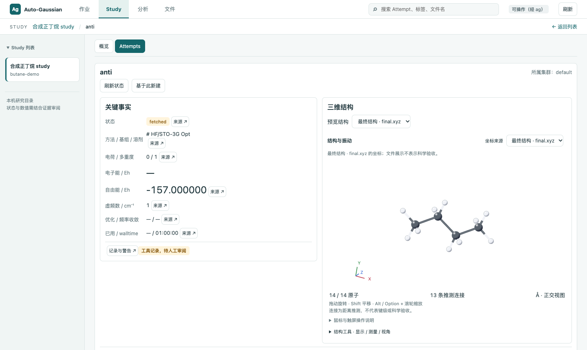
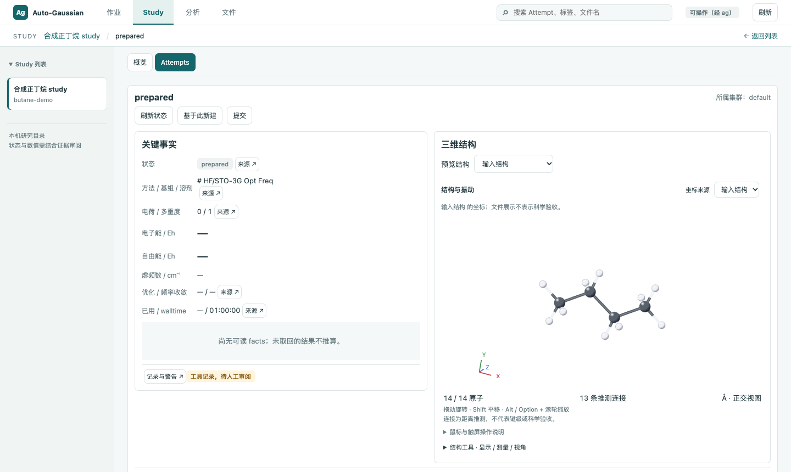
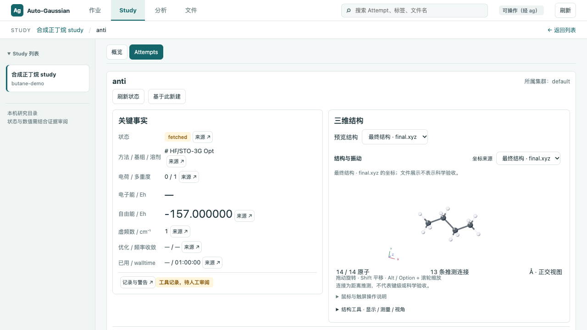
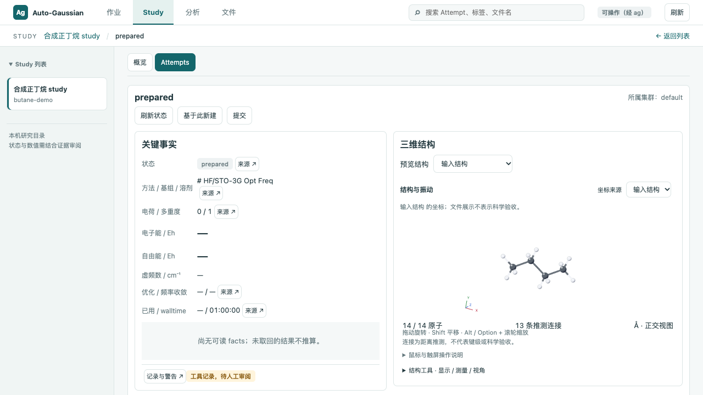

# T96：Attempt 阅读面与操作栏

全部验证使用临时合成正丁烷、水与 fake ag。没有连接服务器或进行计算。

关键事实与三维结构并排；优化过程、频率与虚频审阅、日志、输入、来源与哈希、本地快照分开折叠。展开记忆按 Study / Attempt 隔离，精确文件链接会主动展开目标。模式审阅保持原有动画、原子对距离和已保存报告对照。

## 字段与来源

- 状态来自 status；已用时间仅取 status.elapsed，walltime 取 manifest.walltime。
- 条件显示已有 route / method_basis；电荷和多重度取 facts，缺失时展示输入或 manifest 的已有值。
- 能量、虚频和两类收敛只取 facts 已存字段。缺失为 `—`，不从正常终止推断收敛。
- 电子能与自由能统一六位小数，悬停显示原值。Attempt 表的能量、虚频数和核数右对齐，使用等宽数字。
- 数值来源按钮复用日志搜索与分页；有 fact_sources / job_sections 时限定记录区间，区间外匹配不跳转。未保存日志文件绑定或来源区间时明确显示“当前日志 / 匹配仅供核对”，多日志需人工选择。状态、输入条件等非日志字段打开对应本地记录，不伪造日志行号。
- 快照只读 `snapshots/<目录>/snapshot.json`，保持“运行中快照，不是结果”。不读取快照日志、不把进度写入 facts、不用于签字或分析。

## 动作

ActionBar 沿用已有动作接口：刷新状态；仅 finished 显示普通取回（与 ag fetch 的既有前置条件一致）；prepared 显示提交；新建依赖已有 context.source；取消依赖已有 context.can_cancel，保留 scheduler-residue 判断。unknown / failed_presubmit 没有新建或提交入口。只读模式不渲染操作区。

新建表单与提交摘要放入统一 Drawer，提交摘要确认、Mac 原生确认、固定 argv、CSRF、操作锁、420 秒等待超时后继续运行且不重试均保留。

## T95 负载跟进

运行 `python -B -m scripts.benchmark_study`。该脚本创建临时 synthetic-load Study，20 个 analyses 子目录，每份 JSON 为 2,860,035 字节，44,000 条合成行；通过 FastAPI TestClient 完整测量 `/api/studies/synthetic-load` 请求、序列化与响应接收。此为本机 HTTP 适配器测量，不含 TCP 传输；不是 CI 性能阈值测试。

| 版本 | 第 1 次 / 秒 | 第 2 次 / 秒 | 第 3 次 / 秒 | 中位数 / 秒 | 响应字节 |
|---|---:|---:|---:|---:|---:|
| T95 合并基线 | 8.468138 | 7.839270 | 7.762157 | 7.839270 | 51,923,106 |
| T96 元信息概览 | 0.018932 | 0.016897 | 0.015311 | 0.016897 | 2,986 |
| T96 复测（同时运行浏览器回归） | 0.031281 | 0.059100 | 0.036530 | 0.036530 | 2,986 |

基线超过负责人约定的 1 秒，因此概览仅提供文件名、mtime、schema 导航提示与读取问题，正文在打开报告后按需读取。元信息最多读 JSON 头部 64 KiB；schema 不在可完整解析的前缀中时类型未知，仍可从通用文件入口打开。schema 导航提示不代表完整报告有效，详细读取仍进行原有完整 JSON 检查。原有 4 MiB 文档上限、逐级安全打开、符号链接拒绝保持不变。概览链接直接生成新路由。

## 布局令牌

仅增加布局尺寸令牌，不增加配色或字号：`--header-row-height` 为顶栏既有尺寸，`--header-height` 与 `--context-height` 保存 ResizeObserver 实测值；表头偏移由二者求和。`--attempt-prefix-height` 与 `--attempt-actions-height` 保存首屏之前实际占用的高度；`--attempt-card-height` 在 Attempt 作用域由视口减去这些值与既有留白令牌求得。`--attempt-scene-height` 保留 190px 视图区下限。定义统一位于 `ui/tokens.css`。

默认阅读态采用可用高度；主动展开结构工具、操作说明或振动控制后允许卡片长高，以保留交互内容。点选与平移按 SVG 的实际屏幕变换转换坐标，避免视图区比例变化后的留白导致点击偏移。

## 首屏与截图

Playwright 不滚动，以精确边界断言整个事实卡、整个结构卡均在视口内；同时检查结构视图区至少 190px、结构工具入口可见且页面无横向滚动。没有容差或缩小视口断言。

| 实测区域 | 1440×860 | 1280×720 |
|---|---:|---:|
| 顶栏 / 上下文栏高度 | 46 / 39 px | 46 / 39 px |
| Study 导航高度 | 42 px | 42 px |
| Attempt 标题 / 操作栏高度 | 18 / 33 px | 18 / 33 px |
| 事实 / 结构卡起点 | 239 px | 239 px |
| anti 事实卡高度 / 底边 | 403.20 / 642.20 px | 403.20 / 642.20 px |
| prepared 事实卡高度 / 底边 | 472.77 / 711.77 px | 472.77 / 711.77 px |
| 结构卡高度 / 底边 | 605 / 844 px | 465 / 704 px |
| 结构视图区高度 | 322.41 px | 190 px |
| 超出视口 | 0 px | 0 px |

## 验证

- Python：103 项全量执行，元信息接口切换后的相关测试复测通过；快照与报告读取前后字节、mtime 不变，拒绝符号链接、错误身份、非法 JSON 与超限文档。
- 浏览器：104 项全量执行，失败项修复后按影响面分组复测通过；包含动作状态集合、抽屉、日志定位、模式对照、精确链接与返回恢复、布局与令牌扫描。断言没有放宽。
- TypeScript 类型检查与生产构建通过。远程 CI 结果以 PR 当前提交为准。
- 当前阻塞：等待监督方审阅与负责人合并。没有真实集群或科学验证；没有修改后端 T92 / T93。
