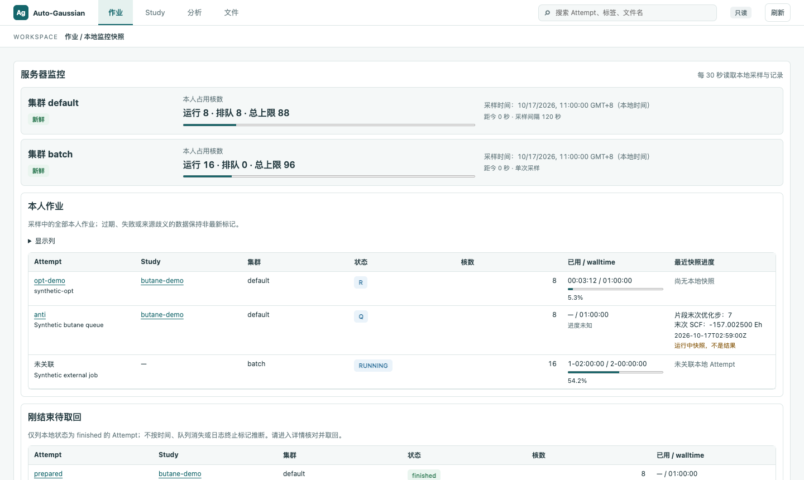
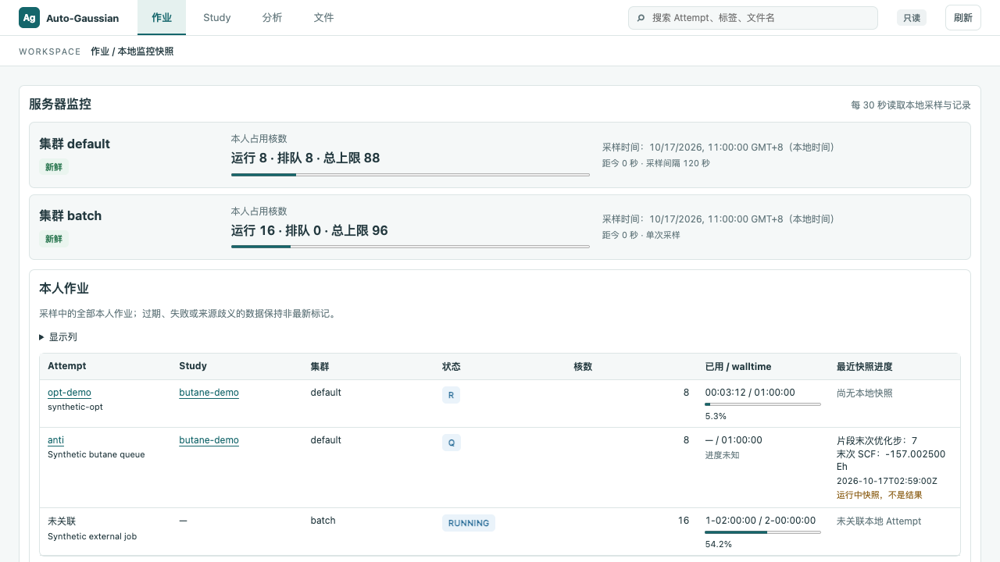

# T97 作业页

页面仅读取本机合成/用户已选根目录中的记录；本次不改 Python 适配器、路径/大小检查、动作接口或 ag。版本号保持不变。

## 数据与口径

- 容量条与本人作业使用 `/api/monitor`，每 30 秒读一次。存在 T51 字段时显示 `cores_running`、`cores_queued`、`committed_cap`；旧快照保留 `cores_in_use / core_cap`，不从作业数推算缺失的分类或额度。
- 新鲜度沿用 T87：连续采样超过三个采样间隔、单次采样超过 600 秒为过期（严格大于）；时钟每秒更新。采样失败、过期和同名 default 来源歧义均标记非最新。首次失败时不显示占位零容量。
- 作业表合并各集群的全部本人作业，包括未关联本地 Attempt 的记录，不从名称猜关联。保留原始调度状态码；作业号、队列、内存与开始时间位于可选列。
- 耗时只取采样的 `walltime_used / walltime_limit`，支持 HH:MM:SS 及 Slurm D-HH:MM:SS。两值完整时展示比例；超限仍显示实际比例，进度条最多填满。缺失或无法识别显示“进度未知”，不估算剩余时间。
- 最近快照通过 T96 的只读摘要接口读取 `snapshot.json`，按有效 `created_at` 选择最近记录；步数、SCF 只取 `progress` 原字段，SCF 六位小数、悬停原值。缺字段显示“—”。有损坏或缺时间记录时明确提示无法确认其是否更新；不读快照日志，不改变 facts。固定显示“运行中快照，不是结果”。
- “刚结束待取回”逐个读取现有 Study 摘要，仅收录本地 `state == finished` 的 Attempt。这里不按年龄截断、不以 mtime、termination 或调度队列消失推断完成，点击进入原详情页；没有添加取回动作。无法读某个 Study 时保留其他 Study，并显示原因。作业仍在旧调度采样中时可能同时出现，两处分别标明采样与本地状态来源。
- 节点、队列、预算、存储、到期和警告保存在每个集群的记忆折叠区。预算仍明确为本地台账、不代表平台余额；旧数据保留非最新标记，硬件容量未知不显示占位零为实际值。

## 外观与验证

使用既有 Panel、DataTable、StatusBadge、Collapsible、EmptyState、ErrorNotice 及 tokens.css，无新增视觉令牌。吸顶表头使用实测顶栏与上下文栏高度变量。

两个视口均严格断言全部两条集群容量条和本人作业表头在不滚动时完全可见（不加容差），且页面无横向滚动。1440×860 / 1280×720 下容量条整体底边为 333.1875 px，表头底边为 486.875 px。截图来自虚构正丁烷 study、虚构调度记录和快照。

新增浏览器覆盖：多集群、快照存在/缺失/损坏、未关联作业、耗时未知、待取回与列表错误隔离、原有可选字段及上述首屏断言。现有监控测试保留连续/单次过期边界、30 秒 GET 轮询、首次失败、来源歧义、预算/存储与原始警告展示。

离线测试和合成浏览器演示不代表真实集群验证或科学验收；本任务不连接集群。

验证结果：Python 3.13.13 全量 103 项通过，TypeScript / Vite 构建通过。浏览器全量首轮 108/110；补齐旧监控折叠区定位、将场景数据预读以避免拦截回调在测试结束后仍在执行，并补充轮询换序的快照身份关联测试，受影响 24 项复测全部通过。当前合计 111 项用例，CI 执行全量。首屏断言与只读断言均未放宽。
